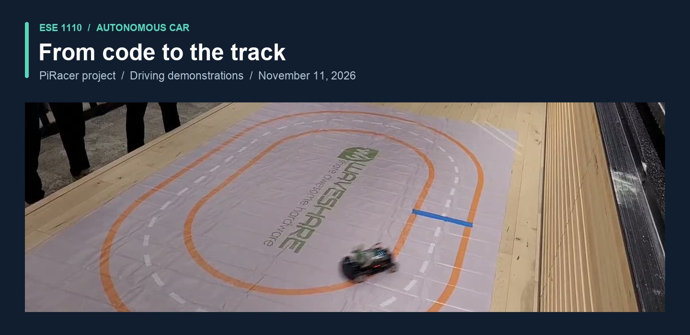
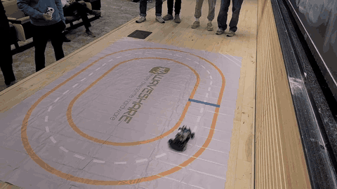
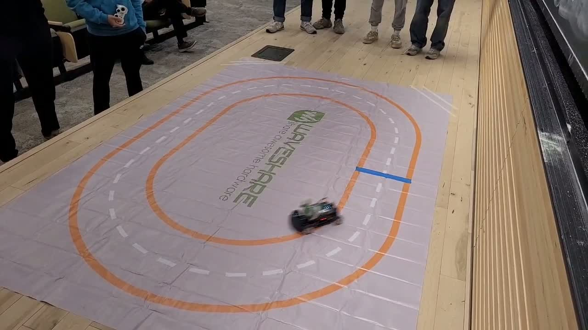
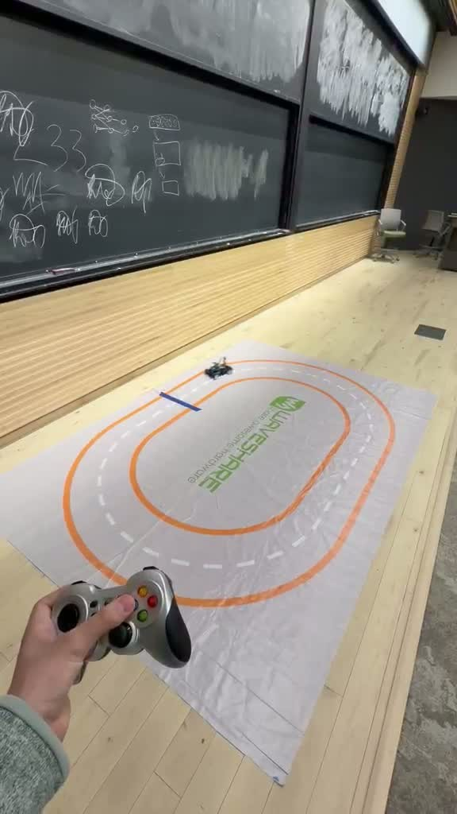

# Autonomous Car · ESE 1110

PiRacer driving demonstrations, control code and model-training files.

## On the track

**[▶ Watch the track run](20261111_180944.mp4)** · **[▶ Watch the test session](11%3A11%3A2026_test.mp4)**

Two driving sessions recorded on **November 11, 2026**. Select a preview below to open the full video.

| Track run | Test session |
| :---: | :---: |
|  |  |
| **[Watch · 33 seconds](20261111_180944.mp4)** | **[Watch · 46 seconds](11%3A11%3A2026_test.mp4)** |
| 1280 × 720 · MP4 | 1024 × 576 · MP4 |

## Explore the project

| Area | Files |
| :--- | :--- |
| **Vehicle control** | [manage.py](manage.py) · [my_joystick.py](my_joystick.py) |
| **Configuration** | [config.py](config.py) · [myconfig.py](myconfig.py) |
| **Training** | [PiRacer Pro training notebook](%5BAsync%5D_PiRacer_Pro_Model_Training.ipynb) · [train.py](train.py) |
| **Models** | [models/](models/) · [old_models/](old_models/) · [older_models/](older_models/) |
| **Data utilities** | [clean_dark_images.py](clean_dark_images.py) · [corrupted_image_fixer.py](corrupted_image_fixer.py) · [recover_tub.py](recover_tub.py) |

The full videos retain their original filenames and quality. Animated previews are shortened, silent excerpts for browsing.
